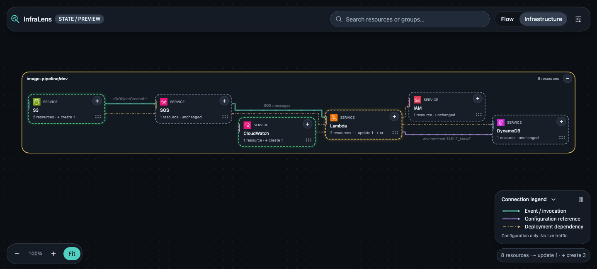

# InfraLens

InfraLens is a local CLI that turns Pulumi and AWS CDK infrastructure into an interactive HTML report. Use it to explore an unfamiliar stack, trace how services are wired together, or review planned changes before deployment.

Each report is a single file with the diagram, search, filters, and a details inspector. Open it directly in a browser, even offline.

## See it in action

Both screenshots show the same synthetic AWS image-processing stack.

### Flow

Follow recognized service connections. Uploads to S3 send events to an SQS queue, which triggers a Lambda function. The function's environment references a DynamoDB table. Select a connection to see the configuration InfraLens used to identify it.


### Infrastructure

Browse the full resource inventory, including IAM roles, log groups, and event configuration. Preview reports highlight additions, updates, replacements, and removals. Enable deployment dependencies when you want to see which resources depend on one another.



## Install

Build from source on macOS or Linux with Go 1.27.4 or later. The installer also requires npm and Node.js 22.12 or a newer supported release.

```bash
git clone https://github.com/maciejpvp/InfraLens.git
cd InfraLens
./scripts/update-global.sh
InfraLens --help
```

The script builds the viewer and installs `InfraLens` in `~/.local/bin`. Add that directory to your `PATH`, or set `INFRALENS_BIN_DIR` to an installation directory of your choice. Run the script again after updating your checkout.

## Try the sample

From the InfraLens checkout, generate the report shown above and open `image-pipeline.html` in your browser. This example uses a [synthetic Pulumi preview](docs/examples/image-pipeline.preview.json) and needs no cloud credentials or provider CLI.

```bash
InfraLens render --provider=pulumi \
  --input docs/examples/image-pipeline.preview.json \
  --output image-pipeline.html
```

## Use InfraLens in your project

Choose a provider explicitly with `--provider`.

| Provider | Project directory for `preview` | File inputs for `render` and `graph` |
| --- | --- | --- |
| `pulumi` | Contains `Pulumi.yaml` or `Pulumi.yml` | Pulumi v3 stack exports or a single JSON preview document with `steps` |
| `aws-cdk` | Contains `cdk.json` | Synthesized CloudFormation templates in JSON format |

### Preview planned changes

Run the command for your provider from the project directory.

```bash
InfraLens preview --provider=pulumi
InfraLens preview --provider=aws-cdk
```

By default, `preview` writes `infralens.html` and opens it in your browser. Use `--no-open` to save it without launching a browser, or `--output review.html` to choose the destination. If preview or report generation fails, an existing report stays in place.

- **Pulumi** uses the active stack and runs `pulumi preview --json --show-sames --non-interactive`. Install the Pulumi CLI, select a stack with `pulumi stack select`, and configure the backend access, dependencies, and provider credentials your project needs. The comparison uses the saved stack state.
- **AWS CDK** uses the project-local CDK CLI when available and otherwise looks for `cdk` on your `PATH`. It synthesizes and compares templates with context lookups disabled. Preview requires CloudFormation read access in the target AWS account and region, as well as any tools required by your app's bundling step. Replacement estimates come from a template comparison.

Both preview workflows execute your IaC project code without deploying resources. Saved-file workflows run locally without invoking Pulumi or CDK.

### Render saved infrastructure data

Use `render` for HTML or `graph` for the normalized JSON graph.

```bash
pulumi stack export --file stack.json
InfraLens render --provider=pulumi --input stack.json --output report.html

InfraLens render --provider=aws-cdk \
  --input cdk.out/MyStack.template.json --output report.html

InfraLens graph --provider=aws-cdk \
  --input cdk.out/MyStack.template.json --output graph.json
```

Repeat `--input` to combine files from the same provider. For Pulumi stack references, pass each file as `--input org/project/stack=FILE` using the exact target identity from `StackReference`. For CDK, use `--input STACK=FILE` to override the stack name inferred from the filename.

## Read and share reports

- **Flow** shows event triggers, invocations, and configuration references that InfraLens recognizes. Use the legend to distinguish connection types and the inspector to see their evidence. The diagram describes IaC configuration. Observed traffic, application behavior, and permissions are outside its scope.
- **Infrastructure** lets you expand service groups, search for resources, and inspect connections. In a preview report, use the filters to switch between connections before and after the change. Pulumi preview reports contain the resources present in `steps`, and CDK previews show removed resources without their former connections.
- **Coverage** depends on the provider and integration. Pulumi preview ingestion supports `same`, `create`, `update`, `delete`, and `replace` in a single document. CDK coverage excludes CloudFormation condition evaluation, resources inside nested stacks, and cross-stack links through `Fn::ImportValue`. Terraform support is planned.
- **Sharing** requires only the HTML file. Raw resource inputs and outputs are excluded from reports. Resource names, property paths, and selected configuration details such as event filters can still reveal project information, so review the report before sharing it.

## Development

The Go CLI embeds the built viewer. After changing the frontend, rebuild the bundle before testing Go or regenerating reports.

```bash
npm ci --prefix internal/render/frontend
npm run build --prefix internal/render/frontend
npm test --prefix internal/render/frontend
go test ./...
```

See the [architecture notes](docs/ARCHITECTURE.md), [product scope](docs/PRODUCT.md), and [roadmap](docs/ROADMAP.md) for project context. InfraLens is distributed under the [MIT License](LICENSE). See the [AWS icon notice](internal/render/icons/NOTICE.md) for icon attribution.
