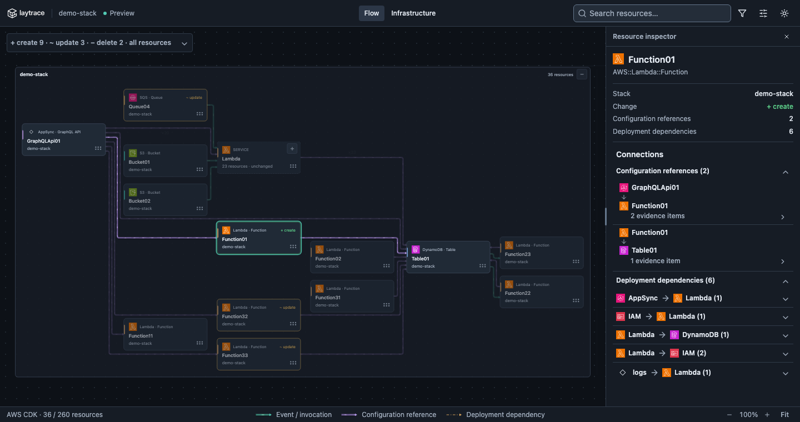

# Laytrace — Pulumi and AWS CDK preview visualizer

Laytrace is an open-source CLI that turns Pulumi previews and AWS CDK changes into interactive HTML reports. Review what will change before deployment, trace connections between services, and estimate AWS costs for individual services and application workflows.

Each report is a single file with a searchable diagram, change filters, and a resource inspector. Open it directly in a browser, even offline. You can also generate a report from a saved export or template.

[Project site](https://maciejpvp.github.io/Laytrace/) · [Try the live demo](https://maciejpvp.github.io/Laytrace/demo.html) · [AWS cost estimates](#estimate-aws-costs) · [Agent guide](https://maciejpvp.github.io/Laytrace/AGENT_GUIDE.md)

## See it in action

The public AWS CDK demo shows AppSync, Lambda, S3, SQS, and DynamoDB connections. Expand the change summary to see affected resources grouped by service. Select a resource or connection to open its details beside the graph. Switch to **Infrastructure** for the full resource inventory and deployment dependencies.

<a href="https://maciejpvp.github.io/Laytrace/demo.html">
  <picture>
    <source media="(prefers-color-scheme: light)" srcset="docs/images/demo-flow-light.png">
    
  </picture>
</a>

## Install

Build from source on macOS or Linux with Go 1.27.4 or later. The installer also requires npm and Node.js 22.12 or a newer supported release.

```bash
git clone https://github.com/maciejpvp/Laytrace.git
cd Laytrace
./scripts/update-global.sh
Laytrace --help
```

The script builds the viewer and installs `Laytrace` in `~/.local/bin`. Add that directory to your `PATH`, or set `LAYTRACE_BIN_DIR` to an installation directory of your choice. Run the script again after updating your checkout.

### Install agent skills

From the Laytrace checkout, install all bundled skills for Codex and Claude Code:

```sh
./scripts/install-skills.sh
```

The script copies the full skill directories to `~/.agents/skills` and `~/.claude/skills`. Rerun it after updating the checkout. Use `codex` or `claude` to select one client, `--dir DIRECTORY` for a custom or project-local destination, and `--dry-run` to preview the install. The script prints backup paths for replaced skills. If a conflicting skill blocks installation, `--replace` backs it up before replacing it. Use `--help` for all options.

## Try the sample

From the Laytrace checkout, generate a small image-processing pipeline report and open `image-pipeline.html` in your browser. This example uses a [synthetic Pulumi preview](docs/examples/image-pipeline.preview.json) and needs no cloud credentials or provider CLI.

```bash
Laytrace render --provider=pulumi \
  --input docs/examples/image-pipeline.preview.json \
  --output image-pipeline.html
```

## Use Laytrace in your project

Choose a provider explicitly with `--provider`.

| Provider | Project directory for `preview` | File inputs for `render` and `graph` |
| --- | --- | --- |
| `pulumi` | Contains `Pulumi.yaml` or `Pulumi.yml` | Pulumi v3 stack exports or a single JSON preview document with `steps` |
| `aws-cdk` | Contains `cdk.json` | Synthesized CloudFormation templates in JSON format |

### Preview planned changes

Run the command for your provider from the project directory.

```bash
Laytrace preview --provider=pulumi
Laytrace preview --provider=aws-cdk
```

By default, `preview` writes `laytrace.html` and opens it in your browser. Use `--no-open` to save it without launching a browser, or `--output review.html` to choose the destination. Each output is replaced only after its write succeeds. If a requested JSON output fails after HTML is saved, the command returns an error and prints the paths it saved.

- **Pulumi** uses the active stack and runs `pulumi preview --json --show-sames --non-interactive`. Install the Pulumi CLI, select a stack with `pulumi stack select`, and configure the backend access, dependencies, and provider credentials your project needs. The comparison uses the saved stack state.
- **AWS CDK** uses the project-local CDK CLI when available and otherwise looks for `cdk` on your `PATH`. It synthesizes and compares templates with context lookups disabled. Preview requires CloudFormation read access in the target AWS account and region, as well as any tools required by your app's bundling step. Replacement estimates come from a template comparison.

Both preview workflows execute your IaC project code without deploying resources. Saved-file workflows run locally without invoking Pulumi or CDK.

### Use Laytrace with a coding agent

Copy the contents of [AGENT_GUIDE.md](AGENT_GUIDE.md) into your IaC project's `AGENTS.md` alongside any existing instructions. If the project has no `AGENTS.md`, save the guide there under that name.

Try “Add a dead-letter queue to UploadsQueue and show me the Laytrace report.” The `infra-report` skill generates a local HTML report after the edit, then links it and summarizes the plan.

Use the CLI to generate a report and ask for specific changes or relationships.

```bash
Laytrace preview --provider=pulumi --no-open \
  --output review.html --graph-output review.json
Laytrace query --input review.json --summary
Laytrace query --input review.json --changed
Laytrace query --input review.json --name UploadsQueue
```

Both `preview` and `render` can produce HTML and graph JSON in one run. Add `--costs --cost-output costs.json` to export the same cost inputs and rates that the report uses. Use a new file or a previous Laytrace report of the matching type for each JSON output. `query` prints JSON and exits. A single match includes direct relationships and evidence. CDK preview relationships describe the target template, and results identify graph coverage and omitted references. [Query options](AGENT_GUIDE.md#query-a-graph)

`query --change replace` includes possible CDK replacements. A possible replacement has `change: "update"` and `mayReplace: true`.

Report generation, queries, and rendering use no LLM calls inside Laytrace.

### Estimate AWS costs

Add `--costs` to a preview or HTML report to fetch regional AWS on-demand prices. Open **Costs** in the report to see how much each service and modeled workflow contributes to the estimate. The public diagram demo shows topology and planned changes.

| View | What you can inspect |
| --- | --- |
| **Services** | Fixed charges, usage charges, and an estimated monthly total per AWS service with [workload assumptions](#import-workload-assumptions). |
| **Workflows** | Cost per run, per million runs, or per month at your expected traffic. Open a modeled workflow to see its resource steps, billable operations, and pricing assumptions. |
| **Compare** | Before and After estimates for previews with both states. Use the same rates and traffic to see how a change affects costs. |
| **AWS catalog rates** | Published unit prices for detected services, including prices for charges whose usage is unknown. |

```bash
Laytrace preview --provider=aws-cdk --costs
Laytrace render --provider=pulumi --input stack.json --output report.html --costs --cost-region eu-west-1
```

In the resource cost view, **Monthly** shows provisioned charges
for a 730-hour month. **Per 1M** shows additional usage charges for one million
incoming requests. Adjust operations per request and Lambda duration under
**Usage assumptions**. **Compare** uses the same workload and prices for both
states. Partial totals include the charges Laytrace could estimate. Open the
info icon in a cell to see what is missing.

`--costs` discovers service offers in the AWS Price List index. Unknown usage
quantities appear as unavailable estimates and are excluded from the partial
total. The saved report and workload controls work offline. The fallback region is
`--cost-region`, then `AWS_REGION` or `AWS_DEFAULT_REGION`, then `us-east-1`.
For CDK comparisons, install AWS CLI and configure access to read the deployed
CloudFormation template in the stack's account and region. Pulumi comparisons
use the old and new resource state in the preview. A stack export or synthesized
template on its own shows a single estimate.

Automatic estimates cover common Lambda, API Gateway, AppSync, DynamoDB, S3,
SQS, SNS and EventBridge charges, plus basic EC2, EBS, RDS, NAT Gateway and load
balancer capacity. S3 starts with Standard read requests. Estimates are in USD
and exclude account discounts, taxes, and free tier. Workflow assumptions
can add usage such as S3 internet egress. The actual bill also depends on
resource configuration and usage that IaC may not describe.

#### Import workload assumptions

Use the portable [cost-estimate skill](skills/cost-estimate/SKILL.md) to analyze a repository
and generate `cost-assumptions.json`. Invoke `$cost-estimate --diff HEAD` in Codex or
`/cost-estimate --diff HEAD` in Claude Code to compare the working tree with HEAD.
Install it along with the other bundled skills using `./scripts/install-skills.sh`.

```bash
Laytrace preview --provider=aws-cdk --costs --cost-assumptions cost-assumptions.json
```

Both `preview` and `render` accept the file. Open **Costs → Workflows**
to price a run, one million runs, or monthly traffic. Choose 1K, 10K or 100K
active users or enter a custom count. The skill derives runs per user and
operation quantities from the application. Laytrace obtains the AWS billing
rates. Select a workflow in Costs or from a resource inspector to show only
its resources and per-run usage on the graph. Inferred connections are dashed. The
monthly project estimate includes the modeled workflows and fixed and shared
charges. **Services** groups the same estimate by AWS service as **Fixed**,
**Usage**, and **Monthly**. Usage includes shared workload such as retained
storage. Before and After use the same user count and can have separate
workload quantities. Version 1 assumption files still work. See the
[workflow JSON format](skills/cost-estimate/references/assumptions.md).

#### Optional billing overrides

Use `--costs --cost-rules costs.json` with `preview` or `render` to supply a
specific billing assumption. The file is keyed by IaC resource type. This
example uses one million S3 PUT requests per bucket.

```json
{
  "AWS::S3::Bucket": {
    "monthly": [],
    "perMillion": [
      {
        "serviceCode": "AmazonS3",
        "usageType": "Requests-Tier1",
        "unit": "Requests",
        "quantity": 1000000
      }
    ]
  }
}
```

Choose a `serviceCode` from the [AWS Price List service index](https://docs.aws.amazon.com/awsaccountbilling/latest/aboutv2/using-the-aws-price-list-bulk-api-fetching-price-list-files-manually.html).
Use an exact `sku` or a `usageType`, together with the AWS billing `unit`. For
ambiguous usage types, add an `operation` or exact CSV column values in
`attributes`. To use a specific catalog region, set `priceRegion`. Use
`"priceRegion": "global"` with an exact SKU for globally published offers.

A meter's `quantity` is the number of AWS billing units per resource per month
or per million incoming requests. Optionally multiply it by a numeric IaC
property with `quantityFrom`, such as `"ClusterConfig.InstanceCount"`. Use
`${Property.Path}` inside `usageType` or an attribute value to select a rate
from the actual resource configuration. Both features evaluate each snapshot
independently. **Usage assumptions** multiplies the `perMillion` quantities
for that resource. An empty metric list sets the metric to zero. An omitted
metric uses the built-in rule where available. Unmatched rates and unresolved
assumptions are marked in the report.

### Render saved infrastructure data

Use `render` for HTML or `graph` for the normalized JSON graph.

```bash
pulumi stack export --file stack.json
Laytrace render --provider=pulumi --input stack.json --output report.html

Laytrace render --provider=aws-cdk \
  --input cdk.out/MyStack.template.json --output report.html

Laytrace graph --provider=aws-cdk \
  --input cdk.out/MyStack.template.json --output graph.json
```

Repeat `--input` to combine files from the same provider. For Pulumi stack references, pass each file as `--input org/project/stack=FILE` using the exact target identity from `StackReference`. For CDK, use `--input STACK=FILE` to override the stack name inferred from the filename.

## Read and share reports

- **Flow** shows event triggers, invocations, and configuration references that Laytrace recognizes. Use the legend to distinguish connection types and the inspector to see their evidence. The diagram describes IaC configuration. Observed traffic, application behavior, and permissions are outside its scope.
- **Infrastructure** lets you expand service groups and inspect connections. In a preview report, use the diagram filters to switch between connections before and after the change. Pulumi preview reports contain the resources present in `steps`, and CDK previews show removed resources without their former connections.
- **Search** matches resource names, services, types, and stacks, including common typos. Use the button beside the search field to narrow results by service, stack, and change status. Selecting a result opens its details on the diagram.
- **Panels** place the inspector beside the graph and Costs below it. Drag a separator or focus it and use the arrow keys to resize a panel. Maximize Costs when you need more room for estimates.
- **Coverage** depends on the provider and integration. Pulumi preview ingestion supports `same`, `create`, `update`, `delete`, and `replace` in a single document. CDK coverage excludes CloudFormation condition evaluation, resources inside nested stacks, and cross-stack links through `Fn::ImportValue`. Terraform support is planned.
- **Sharing** requires only the HTML file. Raw resource inputs and outputs are excluded from reports. Resource names, property paths, and selected configuration details such as event filters can still reveal project information, so review the report before sharing it.

## Development

Start in `cmd/laytrace` for provider registration and `internal/app` for command workflows. The [backend data flow](docs/ARCHITECTURE.md#przepływ-danych) shows how the Pulumi and AWS CDK adapters, cost estimator, and HTML renderer fit together.

The Go CLI embeds the built viewer. After changing the frontend, rebuild the bundle before testing Go or regenerating reports.

```bash
npm ci --prefix internal/render/frontend
npm run build --prefix internal/render/frontend
npm test --prefix internal/render/frontend
go test ./...
```

See the [architecture notes](docs/ARCHITECTURE.md), [product scope](docs/PRODUCT.md), and [roadmap](docs/ROADMAP.md) for project context. Laytrace is distributed under the [MIT License](LICENSE). See the [AWS icon notice](internal/render/icons/NOTICE.md) for icon attribution.
