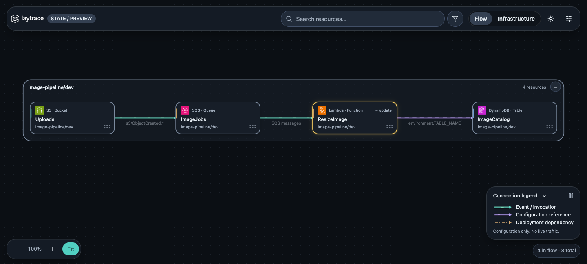

# InfraLens

InfraLens is a local CLI that turns Pulumi and AWS CDK infrastructure into an interactive HTML report. Use it to explore an unfamiliar stack, trace how services are wired together, or review planned changes before deployment.

Each report is a single file with the diagram, search, filters, and a details inspector. Open it directly in a browser, even offline.

## See it in action

Both screenshots show the same synthetic AWS image-processing stack.

### Flow

Follow recognized service connections. Uploads to S3 send events to an SQS queue, which triggers a Lambda function. The function's environment references a DynamoDB table. Select a connection to see the configuration InfraLens used to identify it.



### Infrastructure

Browse the full resource inventory, including IAM roles, log groups, and event configuration. Preview reports highlight additions, updates, replacements, and removals. Enable deployment dependencies when you want to see which resources depend on one another.


## Install

Build from source on macOS or Linux with Go 1.27.4 or later. The installer also requires npm and Node.js 22.12 or a newer supported release.

```bash
git clone https://github.com/maciejpvp/InfraLens.git
cd InfraLens
./scripts/update-global.sh
InfraLens --help
```

The script builds the viewer and installs `InfraLens` in `~/.local/bin`. Add that directory to your `PATH`, or set `INFRALENS_BIN_DIR` to an installation directory of your choice. Run the script again after updating your checkout.

## Try the sample

From the InfraLens checkout, generate the report shown above and open `image-pipeline.html` in your browser. This example uses a [synthetic Pulumi preview](docs/examples/image-pipeline.preview.json) and needs no cloud credentials or provider CLI.

```bash
InfraLens render --provider=pulumi \
  --input docs/examples/image-pipeline.preview.json \
  --output image-pipeline.html
```

## Use InfraLens in your project

Choose a provider explicitly with `--provider`.

| Provider | Project directory for `preview` | File inputs for `render` and `graph` |
| --- | --- | --- |
| `pulumi` | Contains `Pulumi.yaml` or `Pulumi.yml` | Pulumi v3 stack exports or a single JSON preview document with `steps` |
| `aws-cdk` | Contains `cdk.json` | Synthesized CloudFormation templates in JSON format |

### Preview planned changes

Run the command for your provider from the project directory.

```bash
InfraLens preview --provider=pulumi
InfraLens preview --provider=aws-cdk
```

By default, `preview` writes `infralens.html` and opens it in your browser. Use `--no-open` to save it without launching a browser, or `--output review.html` to choose the destination. If preview or report generation fails, an existing report stays in place.

- **Pulumi** uses the active stack and runs `pulumi preview --json --show-sames --non-interactive`. Install the Pulumi CLI, select a stack with `pulumi stack select`, and configure the backend access, dependencies, and provider credentials your project needs. The comparison uses the saved stack state.
- **AWS CDK** uses the project-local CDK CLI when available and otherwise looks for `cdk` on your `PATH`. It synthesizes and compares templates with context lookups disabled. Preview requires CloudFormation read access in the target AWS account and region, as well as any tools required by your app's bundling step. Replacement estimates come from a template comparison.

Both preview workflows execute your IaC project code without deploying resources. Saved-file workflows run locally without invoking Pulumi or CDK.

### Estimate AWS costs

Add `--costs` to a preview or HTML report to include public AWS on-demand prices.

```bash
InfraLens preview --provider=aws-cdk --costs
InfraLens render --provider=pulumi --input stack.json --output report.html --costs --cost-region eu-west-1
```

Open **Costs** above the zoom controls. **Monthly** shows provisioned charges
for a 730-hour month. **Per 1M** shows additional usage charges for one million
incoming requests. Adjust operations per request and Lambda duration under
**Usage assumptions**. **Compare** uses the same workload and prices for both
states. Partial totals include the charges InfraLens could estimate. Open the
info icon in a cell to see what is missing.

`--costs` discovers service offers in the AWS Price List index and fetches
regional prices automatically. Open **AWS catalog rates** to see published
unit prices for the detected services, including services whose usage
quantities are absent from IaC. Those unknown quantities appear as unavailable
estimates and are excluded from the partial total. The saved report and
workload controls work offline. The fallback region is
`--cost-region`, then `AWS_REGION` or `AWS_DEFAULT_REGION`, then `us-east-1`.
For CDK comparisons, install AWS CLI and configure access to read the deployed
CloudFormation template in the stack's account and region. Pulumi comparisons
use the old and new resource state in the preview. A stack export or synthesized
template on its own shows a single estimate.

Automatic estimates cover common Lambda, API Gateway, AppSync, DynamoDB, S3,
SQS, SNS and EventBridge charges, plus basic EC2, EBS, RDS, NAT Gateway and load
balancer capacity. S3 starts with Standard read requests. Estimates are in USD
and exclude account discounts, taxes, and free tier. Workflow assumptions
can add usage such as S3 internet egress. The actual bill also depends on
resource configuration and usage that IaC may not describe.

#### Import workload assumptions

Use the portable [cost-estimate skill](skills/cost-estimate/SKILL.md) to analyze a repository
and generate `cost-assumptions.json`. Invoke `$cost-estimate --diff HEAD` in Codex or
`/cost-estimate --diff HEAD` in Claude Code to compare the working tree with HEAD.
The same folder can be installed globally at `~/.agents/skills/cost-estimate` for
Codex or `~/.claude/skills/cost-estimate` for Claude Code.

```bash
InfraLens preview --provider=aws-cdk --costs --cost-assumptions cost-assumptions.json
```

Both `preview` and `render` accept the file. Open **Costs → Workflows**
to price a run, one million runs, or monthly traffic. Choose 1K, 10K or 100K
active users or enter a custom count. The skill derives runs per user and
operation quantities from the application. InfraLens obtains the AWS billing
rates. Select a workflow in Costs or from a resource inspector to show only
its resources and per-run usage on the graph. Inferred connections are dashed. The
monthly project estimate includes the modeled workflows and fixed and shared
charges. **Services** groups the same estimate by AWS service as **Fixed**,
**Usage**, and **Monthly**. Usage includes shared workload such as retained
storage. Before and After use the same user count and can have separate
workload quantities. Version 1 assumption files still work. See the
[workflow JSON format](skills/cost-estimate/references/assumptions.md).

#### Optional billing overrides

Use `--costs --cost-rules costs.json` with `preview` or `render` to supply a
specific billing assumption. The file is keyed by IaC resource type. This
example uses one million S3 PUT requests per bucket.

```json
{
  "AWS::S3::Bucket": {
    "monthly": [],
    "perMillion": [
      {
        "serviceCode": "AmazonS3",
        "usageType": "Requests-Tier1",
        "unit": "Requests",
        "quantity": 1000000
      }
    ]
  }
}
```

Choose a `serviceCode` from the [AWS Price List service index](https://docs.aws.amazon.com/awsaccountbilling/latest/aboutv2/using-the-aws-price-list-bulk-api-fetching-price-list-files-manually.html).
Use an exact `sku` or a `usageType`, together with the AWS billing `unit`. For
ambiguous usage types, add an `operation` or exact CSV column values in
`attributes`. To use a specific catalog region, set `priceRegion`. Use
`"priceRegion": "global"` with an exact SKU for globally published offers.

A meter's `quantity` is the number of AWS billing units per resource per month
or per million incoming requests. Optionally multiply it by a numeric IaC
property with `quantityFrom`, such as `"ClusterConfig.InstanceCount"`. Use
`${Property.Path}` inside `usageType` or an attribute value to select a rate
from the actual resource configuration. Both features evaluate each snapshot
independently. **Usage assumptions** multiplies the `perMillion` quantities
for that resource. An empty metric list sets the metric to zero. An omitted
metric uses the built-in rule where available. Unmatched rates and unresolved
assumptions are marked in the report.

### Render saved infrastructure data

Use `render` for HTML or `graph` for the normalized JSON graph.

```bash
pulumi stack export --file stack.json
InfraLens render --provider=pulumi --input stack.json --output report.html

InfraLens render --provider=aws-cdk \
  --input cdk.out/MyStack.template.json --output report.html

InfraLens graph --provider=aws-cdk \
  --input cdk.out/MyStack.template.json --output graph.json
```

Repeat `--input` to combine files from the same provider. For Pulumi stack references, pass each file as `--input org/project/stack=FILE` using the exact target identity from `StackReference`. For CDK, use `--input STACK=FILE` to override the stack name inferred from the filename.

## Read and share reports

- **Flow** shows event triggers, invocations, and configuration references that InfraLens recognizes. Use the legend to distinguish connection types and the inspector to see their evidence. The diagram describes IaC configuration. Observed traffic, application behavior, and permissions are outside its scope.
- **Infrastructure** lets you expand service groups and inspect connections. In a preview report, use the diagram filters to switch between connections before and after the change. Pulumi preview reports contain the resources present in `steps`, and CDK previews show removed resources without their former connections.
- **Search** matches resource names, services, types, and stacks, including common typos. Use the button beside the search field to narrow results by service, stack, and change status. Selecting a result opens its details on the diagram.
- **Coverage** depends on the provider and integration. Pulumi preview ingestion supports `same`, `create`, `update`, `delete`, and `replace` in a single document. CDK coverage excludes CloudFormation condition evaluation, resources inside nested stacks, and cross-stack links through `Fn::ImportValue`. Terraform support is planned.
- **Sharing** requires only the HTML file. Raw resource inputs and outputs are excluded from reports. Resource names, property paths, and selected configuration details such as event filters can still reveal project information, so review the report before sharing it.

## Development

The Go CLI embeds the built viewer. After changing the frontend, rebuild the bundle before testing Go or regenerating reports.

```bash
npm ci --prefix internal/render/frontend
npm run build --prefix internal/render/frontend
npm test --prefix internal/render/frontend
go test ./...
```

See the [architecture notes](docs/ARCHITECTURE.md), [product scope](docs/PRODUCT.md), and [roadmap](docs/ROADMAP.md) for project context. InfraLens is distributed under the [MIT License](LICENSE). See the [AWS icon notice](internal/render/icons/NOTICE.md) for icon attribution.
