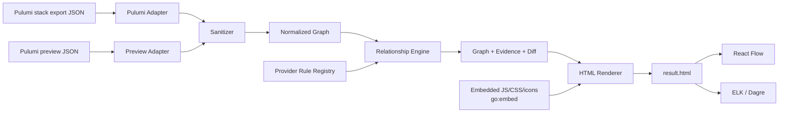
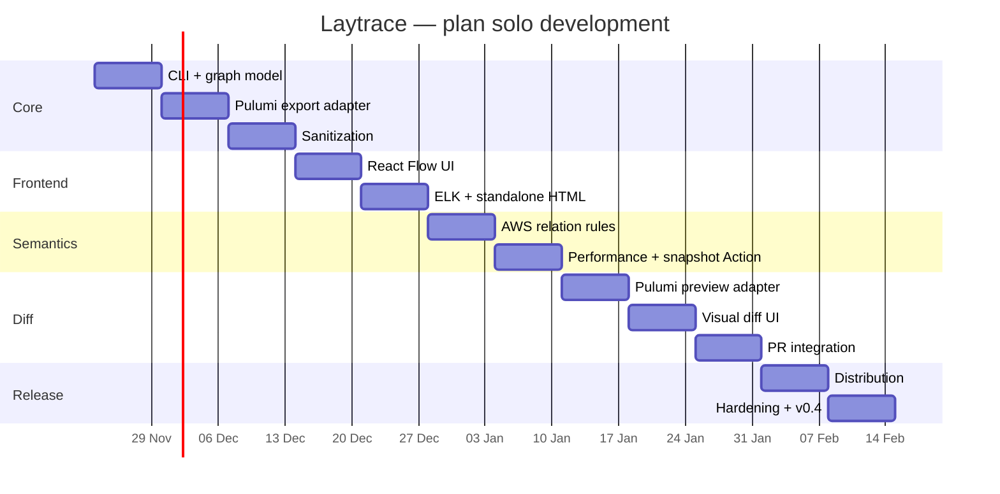

# Laytrace — techniczny plan realizacji open-source CLI do wizualizacji infrastruktury

## Executive summary

**Laytrace ma sens jako małe, lokalne narzędzie developerskie, a nie kolejna platforma.** Najlepszy punkt wejścia to dokładnie ten, który zaproponowałeś: jeden binarny CLI w Go bierze `pulumi stack export`, buduje neutralny graf infrastruktury i generuje **jeden samodzielny `result.html`**, który użytkownik może otworzyć dwuklikiem bez serwera, konta, API keya, CDN-u i dostępu do internetu. Pulumi jest dobrym pierwszym adapterem, bo eksport stosu zawiera zasoby, typy, rodziców, dependencies, inputs i outputs; oficjalny model `ResourceV3` dodatkowo zawiera `propertyDependencies`. citeturn973623search0turn559474search0turn559474search1

Najważniejsza decyzja architektoniczna brzmi: **Laytrace nie powinien być parserem Pulumi. Powinien być silnikiem grafu z adapterem Pulumi.** Dzięki temu późniejszy Terraform i OpenTofu sprowadzą się głównie do napisania kolejnych translatorów do wspólnego `Graph`, zamiast przepisywania renderera. Terraform i OpenTofu mają oficjalne maszynowe reprezentacje JSON dla state i planów poprzez odpowiednio `terraform show -json` i `tofu show -json`, więc ten kierunek ma stabilną podstawę integracyjną. citeturn310309search0turn310309search1turn310309search3turn310309search4

Największym problemem nie będzie HTML ani React. **Najtrudniejsze będzie odróżnienie „Pulumi wie, że A zależy od B” od „A komunikuje się z B”.** `dependencies` oraz `propertyDependencies` oznaczają zależności wdrożeniowe/danych, nie automatycznie ruch sieciowy czy flow aplikacyjne. Dlatego Laytrace powinien mieć cztery jawne klasy relacji: `contains`, `depends_on`, `connects_to`, `triggers`, a każda krawędź musi posiadać źródło dowodu (`evidence`). Oficjalny model Pulumi udostępnia parent, dependencies i property dependencies, co daje solidną bazę dla dwóch pierwszych typów; dwa pozostałe muszą wynikać z kontrolowanych reguł provider-specific. citeturn559474search0turn559474search1

Frontend proponuję zrobić jako **React Flow + ELK.js**, ale z możliwością przełączenia na Dagre. React Flow daje zoom, pan, custom nodes, selection i minimapę; jego dokumentacja wymienia ELK jako rozwiązanie wspierające dynamiczne rozmiary node'ów, sub-flow oraz routing krawędzi. ELK jest bardziej złożony, ale grupowanie VPC/subnet/componentów jest dokładnie przypadkiem, w którym jego możliwości są warte kosztu. citeturn654689search1turn654689search3turn654689search4

InfraSketch jest już znacznie szerszym produktem niż prosty „diagram generator”: obecnie deklaruje osiem formatów IaC, containment, blast radius, diff, plan badges, GitHub Action, eksport PNG/SVG/draw.io/Mermaid, Checkov i Infracost. To oznacza, że **Laytrace nie wygra liczbą ficzerów w pierwszych miesiącach**. Jego sensowna przewaga to: rzeczywisty Pulumi state/preview zamiast analizy kodu źródłowego, jeden offline HTML, jeden natywny binarny CLI, jawna semantyka relacji i bezpieczeństwo danych jako element modelu, a nie późniejszy dodatek. citeturn399012view0turn228336search5

### Pozycjonowanie względem istniejących narzędzi

| Funkcja | Laytrace v0.4 | InfraSketch | Inframap | Rover | Blast Radius | Pluralith |
|---|---:|---:|---:|---:|---:|---:|
| Pulumi state jako źródło prawdy | **Tak** | Nie — Pulumi głównie z kodu źródłowego | Nie | Nie | Nie | Nie |
| Terraform | Po MVP | Tak | Tak | Tak | Tak | Tak |
| OpenTofu | Po MVP | Brak deklarowanego dedykowanego adaptera | Nie | Nie | Nie | Nie |
| Jeden standalone HTML | **Tak** | Aplikacja browserowa / link | Nie, głównie DOT | Standalone ZIP | Kilka assetów / serwer | Nie |
| Interaktywny graf | **Tak** | Tak | Nie w samym output | Tak | Tak | Tak |
| Semantic relations | **Tak, jawne typy** | Inference references | Provider graph | Terraform graph | Terraform dependencies | Terraform graph |
| Visual diff | **Tak, Pulumi preview** | Tak | Nie | Brak deklarowanego diff UI | Nie | Tak |
| GitHub PR artifact | **Tak** | Tak | Nie | Nie | Nie | Tak |
| Backend / konto wymagane | **Nie** | Nie | Nie | Nie | Nie | API/UI wymagane do pełnego użycia |
| Domyślnie offline | **Tak** | Browser-first | CLI | Lokalny serwer / ZIP | Lokalny serwer | Nie |

Źródła funkcji konkurencji: InfraSketch deklaruje interaktywny diagram, diff PR, containment, eksporty, security/cost overlays i GitHub Action; Inframap czyta tfstate/HCL i generuje provider-aware graph; Rover generuje interaktywną wizualizację Terraform i potrafi stworzyć standalone ZIP; Blast Radius używa Graphviz + D3 i lokalnego serwera; Pluralith deklaruje plan changes, drift, cost i CI, ale jego repo informuje o wymaganiu Pluralith UI/API key. citeturn399012view0turn862828search0turn862828search2turn862828search3turn862828search5turn862828search6

Istotna rzecz przy inspirowaniu się InfraSketch: aktualna strona repozytorium pokazuje **niespójność licencyjną** — panel GitHuba oznacza repo jako GPL-3.0, natomiast README mówi AGPL-3.0. Najbezpieczniejszy model dla Laytrace to niezależna implementacja oparta na oficjalnych formatach Pulumi/Terraform/OpenTofu i obserwowalnym zachowaniu produktów, bez kopiowania kodu czy assetów InfraSketch. citeturn399012view0

## Zakres MVP i kolejność dostaw

Nie próbowałbym w pierwszym wydaniu obsłużyć AWS, Azure, GCP, Pulumi, Terraform, Kubernetes, diffa, PNG i GitHuba jednocześnie. Solo projekt bardzo szybko zamieniłby się w niekończący się parser. Cztery wydania powinny budować się jedno na drugim.

| Wersja | Priorytet | Zakres | Co świadomie wypada |
|---|---|---|---|
| **v0.1** | P0 | `pulumi stack export JSON → Graph → result.html`; `contains` z parent; `depends_on`; filtrowanie provider/stack nodes; search; zoom/pan; panel resource; strict sanitization; offline `file://` | semantic traffic, diff, GitHub, Terraform |
| **v0.2** | P0 | provider rule engine; AWS high-confidence `connects_to`/`triggers`; VPC/subnet/component grouping; evidence inspector; filtry edge types; stabilniejsze layouty | pełne pokrycie AWS |
| **v0.3** | P1 | hardening; 500+ resources; snapshot GitHub Action; artefakt HTML; cross-platform releases; diagnostics; Homebrew tap | visual diff |
| **v0.4** | P0 | `pulumi preview --json`; create/update/replace/delete badges; old/new graph union; stabilny layout diffa; PR summary/comment + artifact | Terraform/OpenTofu |

`pulumi stack export` jest lepszym wejściem niż `pulumi stack output --json`: stack export zawiera pełny deployment z resources, inputs, outputs i dependencies, podczas gdy stack outputs reprezentują tylko wartości wyeksportowane przez program. Eksport ma top-level `version` i `deployment`, a w `deployment.resources` znajdują się zasoby stosu. citeturn973623search0turn973623search2turn973623search6

Dla v0.4 nie trzeba wymyślać własnego formatu diffa. Aktualne `pulumi preview --json` domyślnie zwraca pojedynczy `PreviewDigest`; `steps[]` zawiera operację, URN, `oldState`, `newState`, `diffReasons`, `replaceReasons` i `detailedDiff`. Pulumi ma również tryb streaming JSON aktywowany przez `PULUMI_ENABLE_STREAMING_JSON_PREVIEW`, dlatego parser Laytrace powinien rozpoznać oba formaty lub — w pierwszej implementacji — jawnie odrzucić JSONL z komunikatem o wspieranym trybie. citeturn688522search1turn988175view0

### Priorytety adapterów

| Adapter | Format wejścia | Priorytet | Termin | Powód |
|---|---|---:|---|---|
| Pulumi stack | `pulumi stack export` | **P0** | v0.1 | najlepszy wyróżnik projektu |
| Pulumi preview | `pulumi preview --json` | **P0** | v0.4 | visual review przed deployem |
| Terraform plan | `terraform show -json tfplan` | **P1** | po MVP | resolved resources + changes |
| OpenTofu plan | `tofu show -json tfplan` | **P1** | po Terraform | bardzo podobny model JSON, ale osobne testy kompatybilności |
| Terraform/OpenTofu state | `show -json state` | P2 | później | snapshot bez diffa |
| Terraform HCL | pliki `.tf` | P3 | później | wymaga ewaluacji modułów, variables, count, for_each |
| CloudFormation/K8s | JSON/YAML | P3 | później | zwiększa zasięg, ale nie przewagę MVP |

Terraform i OpenTofu wprost dokumentują stabilizowany, wersjonowany JSON output dla state i planów, więc adapter powinien bazować właśnie na nim zamiast na własnym parserze HCL. HashiCorp zaznacza także, że plan JSON zawiera prior state, konfigurację i resource changes. citeturn310309search1turn310309search4

### Docelowe CLI

Pierwszy release powinien być nudny i przewidywalny:

```bash
pulumi stack export --file stack.json

Laytrace render \
  --input stack.json \
  --output result.html
```

Alternatywnie convenience mode:

```bash
Laytrace render \
  --stack my-org/my-project/dev \
  --output result.html
```

Diff:

```bash
pulumi stack export --file stack.json
pulumi preview --json > preview.json

laytrace diff \
  --state stack.json \
  --preview preview.json \
  --output result.html
```

Debugging parsera:

```bash
Laytrace graph \
  --input stack.json \
  --output graph.json
```

Proponowany kontrakt flag:

| Flaga | Default | Znaczenie |
|---|---|---|
| `--input, -i` | — | plik wejściowy |
| `--output, -o` | `result.html` | HTML lub graph JSON |
| `--format` | `auto` | `pulumi-export`, później `terraform-plan`, `tofu-plan` |
| `--stack` | — | opcjonalnie wykonuje lokalny `pulumi stack export` |
| `--sanitize` | `strict` | `strict`, `standard` |
| `--show-internals` | `false` | pokaż stack/provider resources |
| `--layout` | `elk` | `elk`, `dagre` |
| `--direction` | `LR` | `LR`, `TB` |
| `--edge` | `all` | filtr klas relacji |
| `--theme` | `auto` | `auto`, `light`, `dark` |
| `--title` | nazwa stosu | tytuł diagramu |
| `--open` | `false` | otwórz output w przeglądarce |
| `--strict-input` | `false` | błąd przy nierozpoznanych wersjach formatu |
| `--diagnostics` | `stderr` | diagnostyka bez danych zasobów |

Nie dodawałbym `--show-secrets`. Pulumi sam domyślnie pozostawia sekrety zaszyfrowane w stack export, a `--show-secrets` zapisuje je jawnie. Terraform i OpenTofu są jeszcze bardziej niebezpieczne dla przyszłych adapterów: ich dokumentacja ostrzega, że `show -json` pokazuje sensitive values w plaintext. citeturn623581search0turn973623search2turn310309search0turn310309search3

## Architektura systemu i model grafu

Kluczowe jest odseparowanie pięciu warstw: source adapter → sanitizer → normalized graph → relationship engine → renderer. Frontend nigdy nie powinien widzieć surowego Pulumi state.



### Wewnętrzny model

Minimalny IR powinien być kompletnie niezależny od Pulumi:

```go
type Graph struct {
    SchemaVersion int            `json:"schemaVersion"`
    Metadata      GraphMetadata  `json:"metadata"`
    Nodes         []Node         `json:"nodes"`
    Edges         []Edge         `json:"edges"`
}

type Node struct {
    ID         string            `json:"id"`
    Name       string            `json:"name"`
    Type       string            `json:"type"`
    Provider   string            `json:"provider,omitempty"`
    Category   string            `json:"category,omitempty"`
    Attributes map[string]string `json:"attributes,omitempty"`
    Diff       DiffStatus        `json:"diff,omitempty"`
}

type Edge struct {
    ID       string       `json:"id"`
    From     string       `json:"from"`
    To       string       `json:"to"`
    Kind     EdgeKind     `json:"kind"`
    Evidence Evidence     `json:"evidence"`
}

type Evidence struct {
    Source     string  `json:"source"`
    Property   string  `json:"property,omitempty"`
    Confidence float64 `json:"confidence"`
}

type EdgeKind string

const (
    EdgeContains   EdgeKind = "contains"
    EdgeDependsOn  EdgeKind = "depends_on"
    EdgeConnectsTo EdgeKind = "connects_to"
    EdgeTriggers   EdgeKind = "triggers"
)
```

Pulumi `ResourceV3` już przechowuje `URN`, `type`, `parent`, `dependencies`, `propertyDependencies`, inputs i outputs, więc adapter może pozostać stosunkowo cienki. Co ważne, dokładny JSON state nie jest traktowany przez Pulumi jako stabilny publiczny format na poziomie wszystkich pól; Pulumi wskazuje własne typy API jako definicję formatu. Dlatego parser powinien ignorować nierozpoznane pola i zależeć tylko od małego zestawu rzeczy rzeczywiście potrzebnych Laytrace. citeturn559474search0turn559474search3turn973623search10

Nie importowałbym całego Pulumi SDK do pierwszej wersji tylko po to, żeby sparsować state. Lokalny zestaw minimalnych struktur z `json.RawMessage` zmniejsza zależności i pozwala kontrolować powierzchnię danych. Testy kompatybilności powinny natomiast wykorzystywać realne eksporty generowane przez aktualne CLI.

### Semantyka relacji

`contains` powinno powstawać bez heurystyki, jeśli Pulumi `parent` wskazuje inny resource. Dodatkowo provider rules mogą tworzyć logiczne containment, np. VPC → subnet, ale evidence musi wtedy mówić `aws_rule:vpcId`, a nie udawać Pulumi parent. `depends_on` pochodzi z `dependencies` lub dokładniejszych `propertyDependencies`. citeturn559474search1turn973623search0

`connects_to` i `triggers` nie powinny powstawać z prostego „A ma dependency na B”. Zamiast tego potrzebny jest registry:

```go
type RelationRule struct {
    SourceType string
    Property   string
    TargetType string
    TargetKey  string
    Kind       EdgeKind
    Direction  Direction
}
```

Przykładowa reguła:

```text
aws:ec2/instance:Instance
inputs.subnetId
→ aws:ec2/subnet:Subnet
match target.id
contains
```

Inny przykład:

```text
aws:sns/topicSubscription:TopicSubscription
inputs.topic
→ aws:sns/topic:Topic
match target.arn
connects_to
```

Adapter buduje w pamięci indeks wybranych identyfikatorów, np. `id`, wybranych ARN-ów i provider-specific keys. Po utworzeniu relacji **surowa wartość identyfikatora nie musi trafiać do HTML**. To ważna różnica pomiędzy danymi potrzebnymi do budowania grafu a danymi potrzebnymi do jego wyświetlenia.

Najważniejsza zasada UX: `depends_on` powinno wyglądać inaczej od traffic flow. Na przykład dependencies jako przerywana linia, `connects_to` jako pełna, `triggers` jako pełna z innym markerem, `contains` jako grupa zamiast klasycznej strzałki. Dzięki temu diagram nie będzie sugerował ruchu sieciowego tam, gdzie Pulumi podaje jedynie kolejność lub zależność danych.

### Bezpieczeństwo i sanitacja

Laytrace powinien stosować **data minimization**, nie „najpierw wrzuć state do HTML, potem próbuj coś zamazać”. Pulumi export domyślnie nie odsłania plaintext secrets, ale state nadal może zawierać mnóstwo informacji operacyjnych, identyfikatorów i wartości niezdefiniowanych jako Pulumi secrets. citeturn623581search0turn973623search2

Domyślne `strict` powinno umieszczać w HTML tylko nazwę zasobu, normalized type, provider/category, diff status, relacje oraz niewielki allowlist bezpiecznych pól. Nie należy domyślnie embedować całych `inputs`, `outputs`, provider reference, pełnych URN-ów, ARN-ów, account IDs, endpointów ani tags. Sam node ID może być deterministycznym hashem URN-u.

Sanitizer powinien działać przed relationship engine output i posiadać testy „canary secrets”: fixture zawiera np. `LAYTRACE_SECRET_9f...`, a test failuje, jeśli ciąg pojawi się w `graph.json`, `result.html`, stdout lub stderr.

## Frontend, standalone HTML i struktura repozytorium

React Flow jest dobrym wyborem, bo jest MIT-licensed, ma custom nodes/edges, zoom/pan, selection i minimapę. Oficjalna dokumentacja wskazuje ELK jako bardziej zaawansowany layout engine z obsługą sub-flow i edge routing; Dagre jest prostszy, ale React Flow dokumentuje znane ograniczenie Dagre przy sub-flow połączonych z node'ami spoza grupy. citeturn654689search0turn654689search1turn654689search4

Dlatego proponuję: **ELK jako default, Dagre jako fallback/debug mode**. Na początku ELK może dostać bardzo mały zestaw ustawień: `layered`, `RIGHT`, sensowne spacingi i orthogonal routing. Nie budowałbym własnego layout engine.

### Jak zrobić jeden `result.html`

Build-time może wymagać Node/npm. Runtime użytkownika nie powinien.

Pipeline:

```text
web/src/*
   ↓ npm build
web/dist/app.js
web/dist/app.css
   ↓ go:embed
binary laytrace
   ↓ render
result.html
```

Go `//go:embed` oficjalnie pozwala osadzić pliki jako `string`, `[]byte` lub `embed.FS` bez zewnętrznych plików runtime. citeturn310309search6

Przykład:

```go
//go:embed assets/app.js
var appJS string

//go:embed assets/app.css
var appCSS string
```

Generator składa:

```html
<!doctype html>
<html>
<head>
  <style>
    /* app.css inline */
  </style>
</head>
<body>
  <div id="root"></div>

  <script id="laytrace-data" type="application/json">
    { ...sanitized graph... }
  </script>

  <script>
    /* app.js inline */
  </script>
</body>
</html>
```

`encoding/json` w Go domyślnie escape'uje HTML-sensitive characters, ale mimo tego warto mieć osobny test zabezpieczający przed payloadami zawierającymi `</script>`.

**Warunek akceptacji `file://`: zero runtime fetches.** Żadnego CDN, fontów Google, dynamic importów, `fetch("graph.json")`, zewnętrznych SVG ani remote icons. Wszystko inline. E2E powinien otwierać dokładnie `file:///tmp/result.html` i failować, jeśli przeglądarka próbuje wykonać żądanie HTTP/HTTPS.

### UI pierwszego wydania

Na canvasie potrzebujesz tylko node'ów, edge'ów, grup, zoom/pan, search i bocznego panelu. Każdy node pokazuje nazwę, typ i provider/category. Kliknięcie otwiera informacje o relacjach i evidence. Filtry pozwalają wyłączyć np. `depends_on`, żeby zobaczyć tylko semantic flow.

Nie wrzucałbym na start oficjalnych AWS/Azure/GCP icon packów. Generyczne ikony kategoriami typu network/compute/database/storage/queue z permissive library ograniczą problemy licencyjne i rozmiar assetów. Cloud-specific icon packs można później dodawać jako osobne paczki z własnymi notice'ami.

ELK.js jest obecnie publikowany pod `EPL-2.0 OR GPL-3.0-or-later`, natomiast React Flow jest MIT. Jeżeli Laytrace ma być Apache-2.0, dystrybucję bundled ELK trzeba potraktować jako zewnętrzny komponent z zachowaniem jego informacji licencyjnych, zamiast sugerować, że cały bundle jest wyłącznie Apache-2.0. citeturn654689search5turn654689search6turn654689search0

### Struktura repo

```text
laytrace/
├── cmd/
│   └── laytrace/
│       └── main.go
│
├── internal/
│   ├── cli/
│   │   ├── render.go
│   │   ├── diff.go
│   │   └── graph.go
│   │
│   ├── adapters/
│   │   ├── adapter.go
│   │   └── pulumi/
│   │       ├── export.go
│   │       ├── preview.go
│   │       ├── urn.go
│   │       └── fixtures_test.go
│   │
│   ├── graph/
│   │   ├── model.go
│   │   ├── normalize.go
│   │   ├── diff.go
│   │   └── validate.go
│   │
│   ├── relations/
│   │   ├── engine.go
│   │   ├── evidence.go
│   │   └── aws/
│   │       ├── network.go
│   │       ├── compute.go
│   │       ├── messaging.go
│   │       └── rules_test.go
│   │
│   ├── sanitize/
│   │   ├── sanitizer.go
│   │   ├── allowlist.go
│   │   └── sanitizer_test.go
│   │
│   └── render/
│       ├── html.go
│       ├── template.html
│       └── assets.go
│
├── web/
│   ├── src/
│   │   ├── App.tsx
│   │   ├── Diagram.tsx
│   │   ├── model.ts
│   │   ├── layout/
│   │   │   ├── elk.ts
│   │   │   └── dagre.ts
│   │   ├── nodes/
│   │   ├── edges/
│   │   └── components/
│   ├── package.json
│   └── vite.config.ts
│
├── testdata/
│   ├── pulumi/
│   │   ├── basic/
│   │   ├── secrets/
│   │   ├── components/
│   │   ├── aws-network/
│   │   └── large/
│   └── preview/
│
├── action/
│   └── action.yml
│
├── scripts/
│   └── build-web.sh
│
├── .github/
│   └── workflows/
│       ├── ci.yml
│       ├── release.yml
│       └── integration.yml
│
├── .goreleaser.yml
├── go.mod
├── LICENSE
├── NOTICE
└── README.md
```

## Plan realizacji dla solo developera

Realistyczne założenie to **12–16 godzin tygodniowo przez około 12 tygodni**, czyli około 145–190 godzin. Przy pracy praktycznie full-time ten sam zakres można skompresować do około 6–8 tygodni, ale dla side-projectu plan dwunastotygodniowy ma dużo mniejsze ryzyko, że testy i bezpieczeństwo zostaną „na później”.

| Tydzień | Zakres | Estymacja | Rezultat |
|---|---|---:|---|
| Tydzień A | repo, CLI skeleton, fixtures, IR, parser top-level export | 12–14 h | `stack.json → graph.json` |
| Tydzień B | Pulumi resources, URN/name/type, parent, dependency graph | 12–16 h | poprawny normalized graph |
| Tydzień C | sanitizer, canary tests, internals filtering, diagnostics | 12–14 h | bezpieczny graph JSON |
| Tydzień D | React Flow, nodes/edges, search, details panel | 14–18 h | działający frontend dev |
| Tydzień E | ELK, grouping, single HTML, `go:embed`, `file://` tests | 14–18 h | **v0.1** |
| Tydzień F | AWS relation registry, connects/triggers, evidence UI | 14–18 h | **v0.2** |
| Tydzień G | large graphs, filters, UX, benchmarks, GitHub artifact mode | 12–16 h | **v0.3** |
| Tydzień H | PreviewDigest parser, op mapping, old/new state model | 12–16 h | diff graph backend |
| Tydzień I | union layout, diff badges, removed nodes, replace semantics | 14–18 h | visual diff |
| Tydzień J | GitHub Action, artifact, PR summary/comment permissions | 12–16 h | **v0.4 RC** |
| Tydzień K | macOS/Linux/Windows releases, GoReleaser, Homebrew tap | 10–14 h | dystrybucja |
| Tydzień L | docs, examples, compatibility fixtures, bugfixing, launch | 12–16 h | **v0.4 stable** |



### Testy i kryteria akceptacji

Backend powinien mieć unit testy parsera, URN normalization, sanitizer, relation engine oraz diffa. Każdy realny scenariusz Pulumi powinien mieć fixture i golden `graph.json`. Test graphu powinien porównywać semantyczną strukturę, a nie kolejność map czy wygenerowany HTML byte-for-byte.

Frontend: Vitest dla mapperów/modelu, a Playwright dla pełnego artefaktu. Najważniejszy test e2e nie powinien odpalać dev servera: `Laytrace render ...`, następnie `page.goto("file:///.../result.html")`, search node, kliknięcie, filter edge i sprawdzenie braku requestów sieciowych.

Security suite powinna wrzucać sekrety w inputs, outputs, tags, URN-like values i nested objects, następnie wyszukiwać canary w każdym artefakcie i logu.

Test compatibility powinien regularnie generować fixtures najnowszym Pulumi CLI. Obecne dokumenty Pulumi pokazują, że eksport jest JSON-em deploymentu, lecz dokładny format state jest wewnętrznie definiowany w API types, dlatego fixture compatibility jest tutaj istotniejszy niż udawanie, że parser nigdy się nie zmieni. citeturn973623search10turn559474search0

Kryteria akceptacji dla v0.4:

| Obszar | Kryterium |
|---|---|
| Output | dokładnie jeden HTML, bez sibling assets |
| Offline | zero HTTP/HTTPS requests po otwarciu przez `file://` |
| Secrets | zero seeded canary values w HTML/stdout/stderr |
| Pulumi | poprawne `parent`, dependencies i provider/type dla wszystkich fixtures |
| Semantics | żadna heurystyczna edge bez `Evidence` |
| Diff | create/update/replace/delete zgodne z PreviewDigest fixtures |
| Layout | ten sam input daje deterministyczny układ w ramach wersji |
| Scale | fixture 500 resources działa interaktywnie bez crasha |
| CLI | błędny JSON i unsupported input kończą się czytelnym non-zero exit |
| CI | Linux/macOS/Windows przechodzą testy backendu |
| Browser | Chromium + Firefox poprawnie otwierają standalone HTML |
| Action | artifact jest generowany bez przesyłania state do zewnętrznej usługi |

## Ryzyka, dystrybucja i roadmapa po MVP

Największe ryzyka nie dotyczą implementacji Reacta, tylko poprawności modelu oraz bezpieczeństwa.

| Ryzyko | Prawdopodobieństwo / wpływ | Mitigacja |
|---|---|---|
| Sekret trafia do HTML | średnie / krytyczne | strict allowlist, brak raw inputs/outputs, canary tests |
| Fałszywe `connects_to` | wysokie / wysokie | tylko typed provider rules + evidence + confidence |
| Pulumi state schema ewoluuje | średnie / wysokie | minimal tolerant parser, fixtures z aktualnego CLI |
| Preview może być JSON lub JSONL | średnie / średnie | format detection, jawny błąd / później oba tryby |
| 500+ node'ów robi spaghetti | wysokie / średnie | grouping, edge filters, hide dependencies, ELK |
| `file://` psuje asset loading | średnie / wysokie | wszystko inline, brak runtime fetch |
| PR z forka wykonuje obcy kod | wysokie / krytyczne | Laytrace Action nie uruchamia automatycznie obcego Pulumi programu z write tokenem |
| Scope creep | bardzo wysokie | Terraform dopiero po v0.4 |
| Problemy licencyjne ikon/bundli | średnie / średnie | generic icons MVP, `NOTICE`, inventory dependencies |

Szczególnie ważny jest GitHub Action. Nie robiłbym workflow opartego na `pull_request_target`, który checkoutuje i wykonuje kod PR-a z uprzywilejowanym tokenem. GitHub dokumentuje, że `pull_request_target` może dostać read/write permissions również dla forków. Bezpieczniejszy wzorzec to generowanie artefaktu w ograniczonym workflow oraz osobny `workflow_run`, który z minimalnymi permissions pobiera artifact i dodaje komentarz. GitHub pokazuje dokładnie taki wzorzec dla upload artifact → workflow_run → PR comment. citeturn220319search0turn220319search3

Sam komentarz wymaga `issues: write` lub `pull-requests: write`; GitHub REST traktuje PR jako issue dla endpointu comments. citeturn220319search1

W praktyce pierwsza GitHub Action powinna robić:

```text
input stack.json / preview.json
          ↓
     laytrace diff
          ↓
      result.html
          ↓
 actions/upload-artifact
          ↓
 PR summary + artifact link
```

Niech Action **nie zarządza Pulumi credentials, backendem ani `pulumi preview`** w v0.4. Użytkownik może podać JSON z istniejącego joba Pulumi. To drastycznie zmniejsza ryzyko i scope.

### Licencja

Dla samego Laytrace rekomenduję **Apache-2.0**. Jest permissive i zawiera jawny patent grant dla kontrybutorów, co jest sensowne dla narzędzia, które potencjalnie będzie używane w firmowych CI/CD. OSI klasyfikuje Apache License 2.0 jako licencję open-source; jej warunki pozwalają na komercyjne użycie, modyfikację i dystrybucję przy zachowaniu wymaganych notices. citeturn687619search4turn687619search5

Repo powinno mieć `LICENSE`, `NOTICE` i wygenerowany inventory zależności frontendowych. Zależności o innych licencjach, np. ELK, powinny pozostać oznaczone jako third-party components. citeturn654689search5turn654689search6

### Dystrybucja

Najpierw GitHub Releases z binarkami:

```text
laytrace_Darwin_arm64.tar.gz
laytrace_Darwin_x86_64.tar.gz
laytrace_Linux_arm64.tar.gz
laytrace_Linux_x86_64.tar.gz
laytrace_Windows_x86_64.zip
checksums.txt
```

GoReleaser potrafi tworzyć GitHub Releases, uploadować artefakty i generować changelog; może też generować checksumy oraz metadata potrzebne później do package managerów. citeturn687619search0turn687619search1

Drugi kanał to własny Homebrew tap, np.:

```bash
brew install yourname/tap/laytrace
```

Homebrew oficjalnie wspiera third-party taps i rekomenduje repozytoria nazwane `homebrew-*` dla wygodnej instalacji. citeturn687619search2turn687619search6

Docker image zostawiłbym na później. Główną wartością Laytrace ma być właśnie brak potrzeby odpalania kontenera czy lokalnego serwera.

### Metryki sukcesu

Nie mierzyłbym pierwszych miesięcy wyłącznie gwiazdkami GitHuba. Lepsze metryki techniczne to: relation precision na ręcznie oznaczonych fixture'ach, liczba przypadków secret leakage, czas `stack.json → result.html`, czas interaktywności dla grafu 100/500 node'ów, odsetek issue dotyczących błędnej relacji oraz procent użytkowników generujących diagram drugi raz.

Sensowne targety dla pierwszej stabilnej wersji to: **0 wykrytych canary leaks**, >95% precision high-confidence semantic edges w zestawie testowym, poprawne otwarcie standalone HTML bez internetu w Chromium/Firefox, obsługa co najmniej 500 node'ów oraz zero wymaganych usług sieciowych do standardowego `render`.

### Roadmapa po v0.4

Pierwszym etapem po MVP powinien być **Terraform plan JSON**, a zaraz po nim OpenTofu. Obydwa projekty dokumentują JSON plan/state jako format przeznaczony dla integracji, co daje znacznie lepszy fundament niż własna analiza HCL. citeturn310309search1turn310309search4

Dalsza kolejność, którą przyjąłbym dla projektu, to: Terraform/OpenTofu adapter → SVG/PNG export → większy AWS relation pack → Azure/GCP relation packs → blast-radius oparty o jawne edge kinds → Checkov/Infracost overlays → CloudFormation/Kubernetes → plugin API dla community rules.

Najważniejsze, żeby nie rozmyć pierwotnej przewagi. **Laytrace powinien pozostać narzędziem typu `input IaC/state → jeden offline HTML`, a nie stopniowo zamieniać się w dashboard.** InfraSketch już pokrywa bardzo szeroki zakres formatów i funkcji browserowych, Inframap/Blast Radius/Rover pokazują, że istnieje popyt na lokalne wizualizatory Terraform, natomiast Pulumi state + Pulumi preview + standalone artifact pozostaje wystarczająco wąskim i technicznie wyróżniającym punktem wejścia. citeturn399012view0turn862828search0turn862828search2turn862828search3