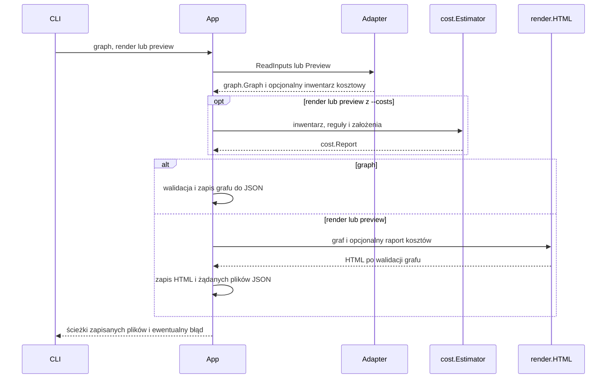

# Architektura v0.1

Status: **backend i interaktywny renderer offline zaimplementowane**. Widok wykorzystuje React Flow, shadcn/ui i Tailwind. Pakiet JS i CSS jest osadzany przez `go:embed`. Gotowy HTML działa bez serwera.
Viewer buduje grupy stos → komponent z aktywnych relacji `contains`. Zwinięcie grupy agreguje widoczne krawędzie z zachowaniem oryginalnych dowodów. ELK.js wyznacza pozycje grup i kart, ortogonalne ścieżki oraz miejsca etykiet. React Flow używa tych współrzędnych do rysowania diagramu i obsługuje kamerę. Kliknięcie wspólnego odcinka pokazuje wszystkie trafione relacje, a wybór klawiaturą otwiera relację z fokusem. Gdy algorytm nie zwróci trasy, raport pokazuje liczbę niepoprowadzonych połączeń.


Adapter Pulumi odczytuje planowane operacje z JSON-a wygenerowanego przez `pulumi preview`. Adapter AWS CDK buduje graf z syntetyzowanych szablonów CloudFormation i nanosi statusy na podstawie `cdk diff`. `Node.change` przechowuje status zmiany, a `Edge.state` rozróżnia relacje `before` i `after`, gdy źródło dostarcza oba stany. CDK pokazuje relacje z docelowych szablonów.

CLI przyjmuje również wiele wejść przez powtarzane `--input [org/project/stack=]FILE`. Adapter Pulumi buduje jeden graf przed rozwiązywaniem referencji. W trybie wielu wejść zachowuje korzenie stosów i tworzy `depends_on` z węzła StackReference do dopasowanego korzenia (evidence: `stackReference`, `inputs.name`). Pełne tożsamości wejść muszą być podane jawnie do rozwiązywania tych połączeń; nie wnioskujemy organizacji z URN. `Node.stack` przechowuje projekt/stos. `graph` i `render` nie interpretują formatu Pulumi.

`mock-topology --project org/project/stack=DIRECTORY` korzysta z `adapters/pulumi/simulate`: uruchamia `deploy` z `infraMocks` i `withStackConfig` na tymczasowej kopii modułu i przechwytuje aktualne rejestracje/odczyty. Następnie używa zwykłego adaptera eksportu, oznacza graf `simulated: true`, a węzły `create`. Renderer pokazuje etykietę symulacji; silnik grafu nie importuje SDK ani runnera. Konfiguracja i odpowiedzi providera są mockowane przez projekt. Runner przechwytuje outputs i podaje je kolejnym projektom przez StackReference; kolejność wejść musi odpowiadać zależnościom. Szczegóły kontraktu i ograniczenia są w README.

## Baza techniczna

- Go: CLI, parser JSON, budowa grafu i składanie HTML.
- React + SVG: komponenty widoku, hooki kamery i historii pływającego inspektora, shadcn/ui i Tailwind.
- Layout warstwowy z grupowaniem cykli przez SCC; pozycjonowanie na podstawie zdarzeń, osobno od referencji konfiguracji.
- Vite buduje frontend w `internal/render/frontend/dist`. Go łączy wynik ze zweryfikowanymi danymi grafu i ikonami w samodzielny plik HTML.
- Gotowy raport działa offline. Generowanie raportu z `--costs` korzysta z publicznego katalogu cen AWS.

Nie dodajemy Dagre jako fallbacku ani interfejsu pluginów przed wykazaniem potrzeby.

Punkt wejścia w `cmd/laytrace` rejestruje adaptery w `app.App` i przekazuje instancję do CLI. CLI parsuje flagi, przekazuje opcje do odpowiedniej metody `App` i prezentuje wynik. `App` wybiera adapter według `--provider` i zarządza przebiegiem komendy oraz zapisem plików.

## Przepływ danych



Przy `graph` i `render` adapter dostaje listę wejść oraz funkcję do ich bezpiecznego otwarcia, dostarczoną przez `App`. Adapter interpretuje format źródłowy, rozwiązuje relacje i zwraca wspólny graf. Przy `--costs` wypełnia też `cost.Inventory` danymi używanymi do wyceny. `cost.Estimator` rozwiązuje założenia, pobiera stawki i zwraca osobny `cost.Report`. HTML osadza graf i koszty w osobnych blokach JSON. `--graph-output` zapisuje graf, a `--cost-output` zapisuje raport kosztów.

`query` korzysta z `App.Query`, które odczytuje zapisany graf Laytrace, waliduje go i deleguje filtrowanie do pakietu `graph`. CLI wypisuje wynik w JSON na stdout. Wycofywane `mock-topology` korzysta z symulatora Pulumi i wspólnej ścieżki zapisu HTML.

Do renderera trafia wspólny graf i opcjonalny raport wyceny. Inwentarz właściwości używanych przez estimator pozostaje danymi roboczymi. Przed udostępnieniem raportu sprawdź nazwy zasobów, ścieżki właściwości i wybrane wartości konfiguracji widoczne w dowodach relacji.

## Minimalny kontrakt grafu

| Element | Pola / zasada |
|---|---|
| Graph | `schemaVersion`, `nodes`, `edges`, `omittedRelations` oraz opcjonalne `previewProvider` i `simulated`. |
| Node | `id`, `name`, `type`, `provider`. Adapter może podać `service` dla ikony i grupowania oraz `stackRoot` dla węzła reprezentującego stos. |
| Edge | `from`, `to`, `kind`, opcjonalny `state`, `evidence[]`; tożsamość przez końce, typ i stan. |
| Evidence | Źródło (`parent`, `dependencies`, `propertyDependencies`, `aws_rule`), opcjonalna ścieżka właściwości, ID zasobu konfigurującego relację oraz tekstowe `label` i `details` z jawnie dopuszczonych pól konfiguracji. |

- Pulumi wylicza ID węzła z URN, a CDK z nazwy stosu i logicznego ID zasobu. Skróty zapewniają stabilne odwołania w grafie.
- `contains`: **rodzic → dziecko**.
- `depends_on`: **zasób zależny → zasób, od którego zależy**. Kierunek objaśnia legenda.
- Jedna krawędź na `(from, to, kind, state)` z uporządkowaną listą dowodów.
- Węzły i krawędzie sortowane deterministycznie; frontend używa tej kolejności przy layoucie.
- Cykle dependencies są dozwolone w modelu; błędna hierarchia rodziców musi być wykryta i zgłoszona bez zapętlenia UI.

`triggers` oznacza konfigurację zdarzenia/wywołania, `connects_to` — referencję konfiguracji, bez deklarowania kierunku odczytu/zapisu. Reguły AWS są wewnątrz adaptera (`aws.go`), więc model i renderer nie importują Pulumi ani AWS. Widok flow pokazuje tylko te dwa typy.

Reguły AWS mogą korzystać z jawnych referencji `propertyDependencies` do zgodnych typów zasobów, gdy wartości preview są nieznane. BucketNotification → Lambda, API Gateway v2 `AWS_PROXY` → Lambda oraz środowisko Lambda → EC2 tworzą wtedy `connects_to` z ID zasobu konfigurującego integrację i ścieżką właściwości jako dowodem. Nie zamieniamy ogólnych dependencies na przepływ. Indeksy referencji są osobne dla before/after; brakujące ID i outputs nowej rejestracji uzupełniamy ze starego stanu wyłącznie dla operacji `same`.

Parent jest jawną relacją, bez wywnioskowanych grup sieciowych. Po ukryciu stack/provider nodes usuwamy ich krawędzie; nie przepinamy ich automatycznie do innych zasobów. Brakujący cel daje liczbową diagnostykę bez surowego identyfikatora, a nie wymyślony zasób.

Dowody przepływu mają opcjonalne `label`/`details` bez zmiany `schemaVersion: 1`. Opisy są częścią tożsamości dowodu, nie krawędzi: wiele tras i filtrów pozostaje przy jednym połączeniu. Adapter dopuszcza ścieżki API, zdarzenia, filtry i wybrane parametry; formatuje je jako tekst i ukrywa oznaczone sekrety, URL-e, ARN-y oraz IP. Renderer deduplikuje opisy prezentacyjne, zachowuje wszystkie źródła dowodów i używa istniejącego pozycjonowania etykiet. Starsze grafy bez opisów pozostają poprawne.

## CLI

```bash
Laytrace preview --provider=pulumi [--output laytrace.html] [--no-open]
Laytrace render --provider=pulumi --input stack.json --output result.html
Laytrace graph --provider=pulumi --input stack.json --output graph.json
```

`preview` działa w katalogu projektu Pulumi: wykonuje `pulumi preview --json --show-sames --non-interactive`, wymusza niestreamingowy JSON, odczytuje wynik z prywatnego pliku tymczasowego i zapisuje HTML wspólnym rendererem React. Następnie otwiera plik systemowym launcherem, a plik tymczasowy usuwa po zakończeniu komendy. Preview wykonuje kod projektu, korzysta z aktywnego stosu i credentials; nie wykonuje wdrożenia. Błąd otwarcia przeglądarki nie cofa udanego zapisu. W `graph`/`render` obie ścieżki są jawnie wymagane. CLI obsługuje pomoc. Sukces: kod `0`; błąd: kod niezerowy i krótka diagnostyka na stderr, bez fragmentów dokumentu wejściowego. Istniejący wynik jest zastępowany dopiero po poprawnym przygotowaniu nowego; wejście nie może być wyjściem.

Bez autodetekcji wielu adapterów, `--stack`, `--open`, wyboru theme/layoutu i profili sanitacji. Obsługiwana wersja eksportu jest walidowana; nieznane pola wewnątrz wspieranej wersji są ignorowane.

## Bezpieczeństwo artefaktu

- Brak surowych inputs/outputs, ciphertextów, provider references, pełnych URN/ARN, endpointów, tags i identyfikatorów konta.
- Nazwa i typ pozostają danymi wejściowymi: wyświetlamy je jako tekst, nigdy jako HTML. Polityka nazw wymaga decyzji przed wydaniem.
- Ścieżki właściwości w evidence też są danymi wejściowymi; objęte przeglądem minimalizacji i testami wycieków.
- JSON osadzamy z escapowaniem bezpiecznym dla HTML; osobny test dla `</script>` i złośliwych etykiet.
- Żadnych runtime fetch, CDN, zewnętrznych fontów, ikon, dynamicznych importów ani osobnych assetów.
- Brak automatycznego otwierania URL-i pochodzących z eksportu.
- Canary tests sprawdzają HTML, graph JSON, stdout i stderr. Nie dowodzą, że dowolny eksport jest anonimowy.

## Podział kodu

```text
cmd/laytrace/                     rejestracja adapterów i uruchomienie CLI
internal/cli/                      flagi, komunikaty i otwarcie przeglądarki
internal/app/                      przebieg komend i zapis raportów
internal/adapters/pulumi/          eksport i preview Pulumi
internal/adapters/awscdk/          szablony CloudFormation i preview AWS CDK
internal/adapters/pulumi/simulate/ rejestrowanie zasobów z mocków projektów Go
internal/graph/                    wspólny model, normalizacja, walidacja i zapytania
internal/cost/                     inwentarz, reguły, założenia i estymacja kosztów
internal/fileio/                   operacje plikowe i atomowy zapis
internal/render/                   składanie raportu HTML i osadzanie zasobów
internal/render/frontend/src/      widok React, układ i trasowanie połączeń SVG
scripts/check_html.py              test offline desktop/mobile
testdata/                          fixture’y do testów
```
